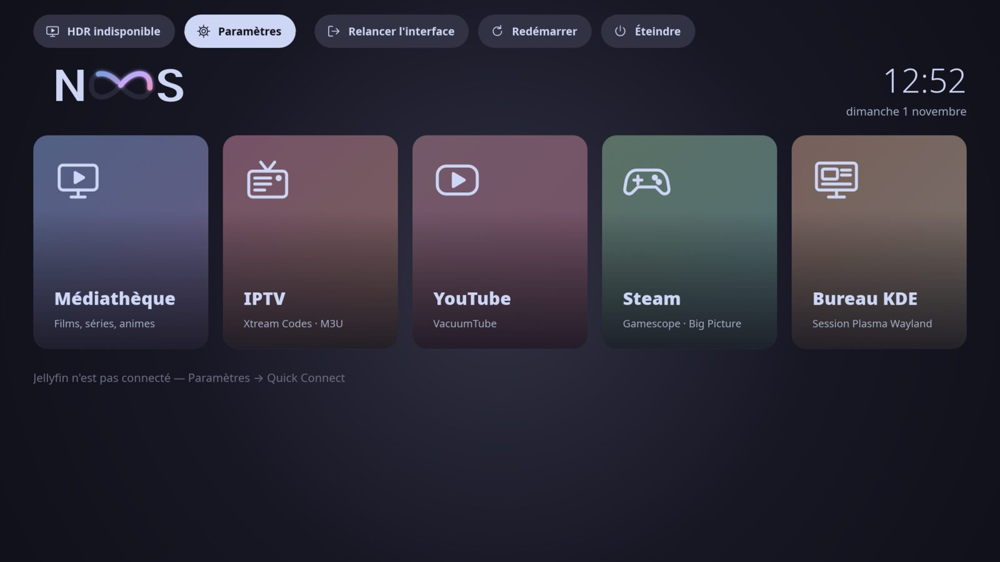
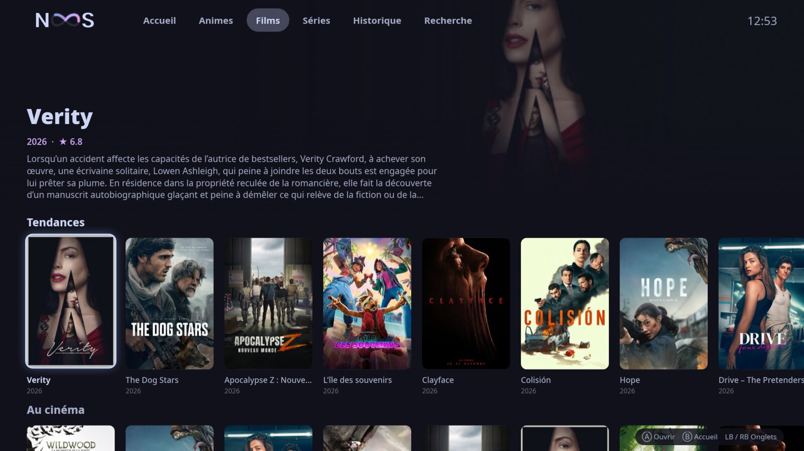
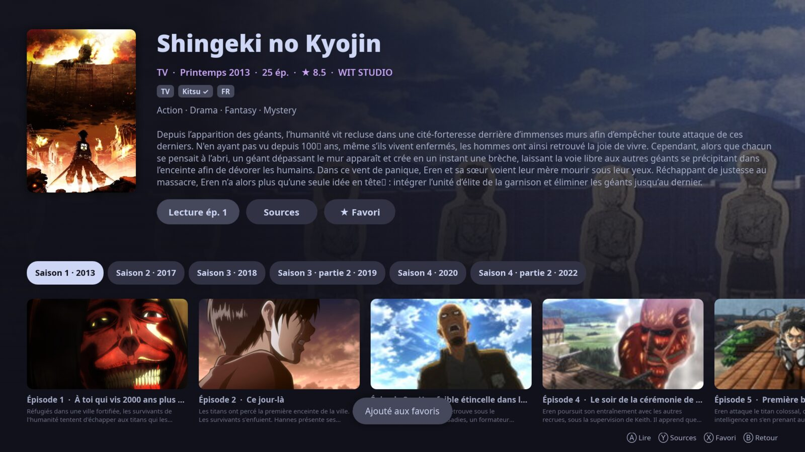
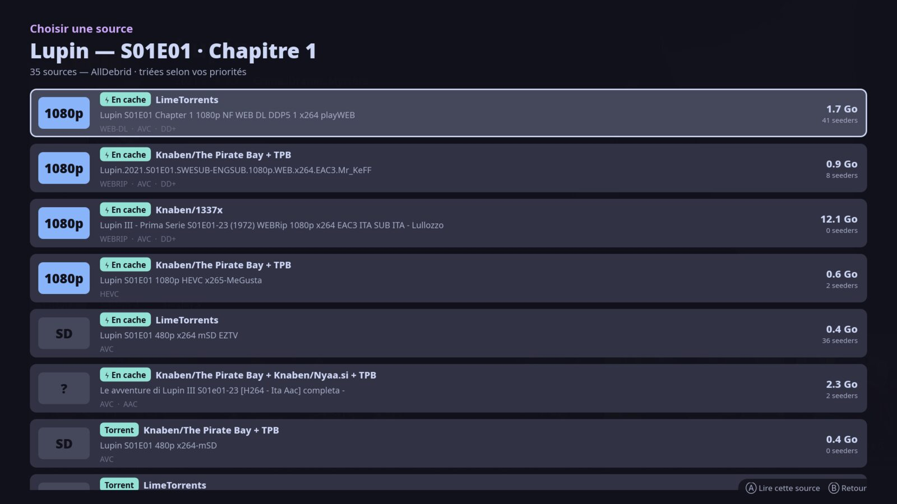
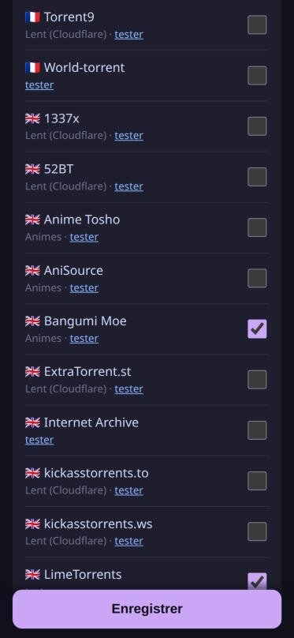

<div align="center">


# Noosfin

**Le tableau de bord HTPC pour Bazzite.**
Allumez le PC, prenez la manette : films, séries, animes, IPTV, YouTube, Steam et bureau KDE, en HDR.

[](https://github.com/Chomiam/noosfin/releases/latest)
[](https://bazzite.gg)
[](https://slint.dev)
[](LICENSE)



</div>

---

## ⚡ Installation en une ligne

```bash
curl -fsSL https://raw.githubusercontent.com/Chomiam/noosfin/main/install.sh | bash
```

L'installateur vérifie votre système, propose les options puis installe tout :

```text
                      ███╗   ██╗ ██████╗  ██████╗ ███████╗███████╗██╗███╗   ██╗
                      ████╗  ██║██╔═══██╗██╔═══██╗██╔════╝██╔════╝██║████╗  ██║
                      ██╔██╗ ██║██║   ██║██║   ██║███████╗█████╗  ██║██╔██╗ ██║
                      ██║╚██╗██║╚██████╔╝╚██████╔╝╚════██║██╔══╝  ██║██║╚██╗██║
                      ╚═╝  ╚═══╝ ╚═════╝  ╚═════╝ ╚══════╝╚═╝     ╚═╝╚═╝  ╚═══╝
                            Tableau de bord HTPC pour Bazzite  ·  v0.1.0
  ╭ Vérification du système ─────────────────────────────────────────────────────────────╮
  │   ✔  Bazzite                   bazzite-deck · Stable (F44)                            │
  │   ✔  Bureau KDE Plasma         KWin gère le HDR de la session                         │
  │   ✔  Session Steam Gamescope   disponible : tuile Steam sur le tableau de bord        │
  │   ✔  Carte graphique           AMD                                                    │
  │   ✔  Flatpak                   présent (lecteur mpv)                                  │
  │   ✔  Podman                    présent (FlareSolverr local)                           │
  ╰───────────────────────────────────────────────────────────────────────────────────────╯
```

> [!IMPORTANT]
> Noosfin ne fonctionne **que sur Bazzite**, édition **KDE** (Deck ou bureau, AMD, Intel ou NVIDIA).
> Les éditions GNOME ne sont pas prises en charge : la session repose sur KWin.

| Édition | Tableau de bord | Tuile Steam (Gamescope) |
|---|:---:|:---:|
| `bazzite-deck` | ✅ | ✅ |
| `bazzite-deck-nvidia` | ✅ | — |
| `bazzite` (bureau KDE) | ✅ | — |
| `bazzite-nvidia` | ✅ | — |
| `bazzite-gnome`, `bazzite-deck-gnome` | ❌ | ❌ |

## ✨ Fonctionnalités

<table>
<tr>
<td width="50%"></td>
<td width="50%"></td>
</tr>
<tr>
<td><b>Médiathèque</b> · tendances, nouveautés et recherche TMDB, fiches et épisodes en français.</td>
<td><b>Animes</b> · AniList, saisons regroupées comme sur TheTVDB, reprise et épisode suivant.</td>
</tr>
<tr>
<td width="50%"></td>
<td width="50%" align="center"></td>
</tr>
<tr>
<td><b>Moteur de sources intégré</b> · trackers et débrideur, triés selon vos priorités.</td>
<td><b>Configuration depuis le téléphone</b> · un QR code à l'écran, les clés se tapent sur le mobile.</td>
</tr>
</table>

- 🖥️ **Session dédiée** : Noosfin s'ouvre au démarrage (SDDM) dans KWin, qui gère le HDR. Le curseur est masqué, tout se fait à la manette ou au clavier.
- 🔀 **Changement de session** : Bureau KDE et Steam (Gamescope, éditions Deck) en un appui, retour automatique au tableau de bord.
- 🎬 **Lecture mpv** : `gpu-next` + Vulkan Wayland, HDR10 / Dolby Vision transmis à l'écran, overlay moderne à la manette (pistes audio, sous-titres, infos).
- 🧲 **Sources** : AllDebrid, TorBox ou Real-Debrid ; trackers privés Torznab (C411, Tr4ker, UNIT3D…) ; Knaben, YTS, EZTV, Nyaa, SubsPlease et 35 trackers publics intégrés (définitions Prowlarr interprétées par l'app, sans Prowlarr).
- 🎯 **Priorités** : langue (VFF, MULTi, VOSTFR…), sous-titres, résolution, HDR, codec, cache, taille.
- 🛡️ **Réseau** : DNS chiffré contre les blocages des FAI ; FlareSolverr local (podman) pour les sites Cloudflare.
- 📺 **IPTV** : Xtream Codes et M3U, catégories, recherche, favoris, décodage matériel selon le GPU.
- ▶️ **YouTube** : VacuumTube (YouTube TV), installé à la demande.
- ⭐ **Favoris et historique** enregistrés localement.
- 🔄 **Mises à jour** depuis GitHub : *Paramètres → Mise à jour*.

## 🚀 Premiers pas

1. Au démarrage, Noosfin s'ouvre tout seul (ou lancez « Noosfin » depuis le menu KDE).
2. **Paramètres → Sources & débrideur** : scannez le QR code avec votre téléphone, puis renseignez
   - votre clé de débrideur (AllDebrid, TorBox ou Real-Debrid) ;
   - une clé [TMDB](https://www.themoviedb.org/settings/api) (gratuite) pour les catalogues en français ;
   - vos trackers privés et vos priorités.
3. **Paramètres → Clavier physique** si votre clavier n'est pas en AZERTY.

## 🔄 Mise à jour et désinstallation

- **Mise à jour** : *Paramètres → Mise à jour* (vérification automatique au lancement), ou relancez la commande d'installation.
- **Désinstallation** (la configuration est conservée) :

```bash
~/.local/bin/noosfin-installer --uninstall
```

## 🎮 Commandes

| Manette | Clavier | Action |
|---|---|---|
| Ⓐ | Entrée | Ouvrir / lire |
| Ⓑ | Échap | Retour |
| Ⓨ | Tab | Liste des sources |
| Ⓧ | F | Favori |
| LB / RB | Page ↑ / ↓ | Onglet précédent / suivant |
| Select | — | Informations de lecture (dans mpv) |
| Start / Guide | Début | Tableau de bord |

## 🧩 Fonctionnement

<details>
<summary><b>Session et changement de session</b></summary>

Le fichier `/etc/sddm.conf.d/zzs-noosfin-autologin.conf` fait de **Noosfin HTPC** la session par défaut. Sur les éditions
Deck, « Bureau KDE » et « Steam » posent une session ponctuelle via le D-Bus de steamos-manager
(`SetTemporarySession`) ; à la déconnexion, SDDM revient sur Noosfin. Sinon, `noosfin-session` lance Plasma lui-même
et reprend la main à sa fermeture. La session lance `kwin_wayland` seul, avec la configuration d'écran de Plasma
(HDR compris).
</details>

<details>
<summary><b>Moteur de sources</b></summary>

`src/scraper/` interroge en parallèle les trackers privés (Torznab, `.torrent` transmis avec la passkey), les sources
publiques et les trackers intégrés (`assets/indexers/`, format Cardigann de Prowlarr interprété par
`src/scraper/cardigann.rs`). Les résultats sont dédupliqués par infohash, triés selon vos critères, le cache du débrideur
est vérifié, puis le premier lien lisible est envoyé à mpv. Les animes sont cherchés par titres romaji / anglais avec la
saison déduite d'AniList ; dans un pack, le bon épisode est choisi chez le débrideur.

```bash
noosfin --search movie tt0816692 "Interstellar" 2014   # recherche en console
noosfin --test-trackers                                 # teste les trackers intégrés
```
</details>

<details>
<summary><b>Fichiers</b></summary>

| Chemin | Contenu |
|---|---|
| `~/.config/noosfin/config.toml` | réglages généraux, lecteur, clavier |
| `~/.config/noosfin/sources.json` | débrideur, trackers, TMDB, priorités (droits 600) |
| `~/.local/share/noosfin/state.json` | favoris, historique, reprises |
| `~/.local/state/noosfin/session.log` | journal de la session |
</details>

## 🛠️ Compiler depuis les sources

Sur Bazzite (Rust via [rustup](https://rustup.rs)) :

```bash
git clone https://github.com/Chomiam/noosfin && cd noosfin
./packaging/dev-install.sh              # compile et installe, puis la session SDDM (sudo)
./packaging/package.sh                  # archive de release dans dist/
```

Bazzite n'a pas de paquets `-devel` : `build-sys/` fournit un stub pkg-config pour fontconfig.
Les releases sont construites par GitHub Actions dans un conteneur Fedora à chaque tag `v*`.

## 🙏 Remerciements

[Bazzite](https://bazzite.gg) · [Slint](https://slint.dev) · [ratatui](https://ratatui.rs) · [mpv](https://mpv.io) ·
[TMDB](https://www.themoviedb.org) · [AniList](https://anilist.co) · [ani.zip](https://api.ani.zip) ·
[Prowlarr Indexers](https://github.com/Prowlarr/Indexers) · [FlareSolverr](https://github.com/FlareSolverr/FlareSolverr) ·
[VacuumTube](https://github.com/shy1132/VacuumTube)

Ce produit utilise l'API TMDB mais n'est ni approuvé ni certifié par TMDB.

Licence [GPL-3.0](LICENSE).
